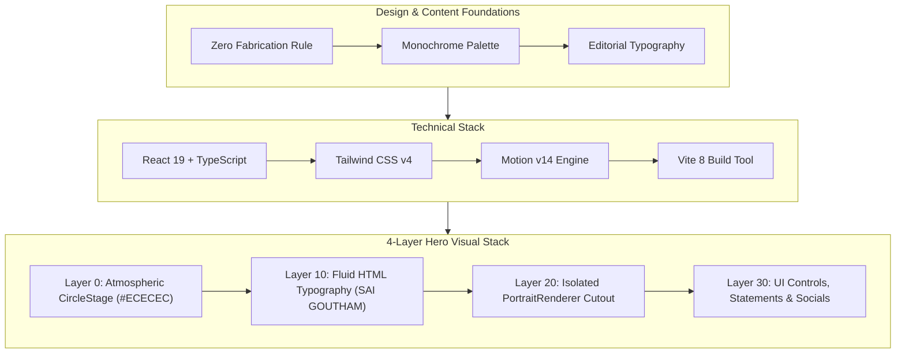
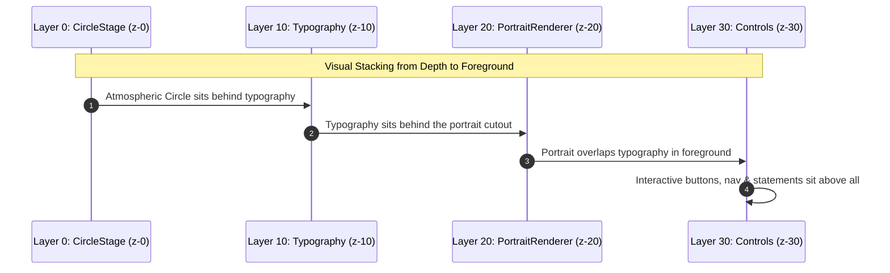

# PROJECT REPORT — VERSION 1.0 (v1)
**Project:** Personal Editorial Portfolio  
**Subject:** Burka Sai Goutham — 3-1 B.Tech Data Science Undergraduate (Expected Graduation: 2028)  
**Workspace:** `D:\Portfolio`  
**Date:** October 2, 2026  
**Status:** Production-Ready v1 Baseline  

---

## 1. Executive Summary

This project report documents the design, architecture, implementation, and verification of the personal portfolio website for **Burka Sai Goutham**. Built from a clean repository, the portfolio is an editorial, monochrome personal site constructed to communicate technical foundations in Data Science, mathematical statistics, algorithms, and AI tool orchestration.

The portfolio is explicitly engineered as a high-fidelity personal representation—**not** an AI chatbot, SaaS marketing page, or generic developer template. Every visual decision, typography scale, component, and data structure strictly adheres to the established source of truth:
- `DESIGN_DOC.md` (Aesthetic, typography, color palette, responsive behavior)
- `TECHSTACK.md` (React 19, TypeScript, Tailwind CSS v4, Motion, Oxlint)
- `portfolio_working_spec.md` (Strict zero-fabrication rules, honest academic positioning)
- Authentic Visual Reference (`Monochrome Data Science Portfolio Portrait.png`)



---

## 2. Technical Stack & Build Infrastructure

| Layer | Technology | Version | Purpose & Rationale |
| :--- | :--- | :--- | :--- |
| **Framework** | React | 19.x | Strict component tree, concurrency, and performance |
| **Language** | TypeScript | 5.x | End-to-end typed schemas for profile, capability, and education data |
| **Bundler** | Vite | 8.3.2 | Sub-second HMR and optimized tree-shaken static production bundles |
| **Styling** | Tailwind CSS | 4.x (`@tailwindcss/vite`) | Zero-runtime CSS-first styling engine with theme variables |
| **Motion** | Motion | 14.x (`motion/react`) | Fluid physics-based animations, orchestrations, and GPU transforms |
| **Icons** | Lucide React + Custom SVG | Latest | Monochromatic iconography with precise line weights |
| **Linter** | Oxlint | Latest | High-speed Rust-based linting engine |

### Build & Compilation Metrics
- **Production Build Time:** 608 ms (`vite build`)
- **Lint Status:** 0 warnings, 0 errors across 25 source files (`oxlint`)
- **Asset Bundle:** 
  - CSS: `38.26 kB` (`7.39 kB` gzipped)
  - JS: `392.49 kB` (`122.33 kB` gzipped, includes React 19 runtime & Motion engine)
  - Portrait Cutout: `1.09 MB` (lossless transparent PNG)

---

## 3. Hero Composition Architecture (v1 Milestone)

The primary design requirement of v1 was to translate the editorial reference graphic into an independent, production-grade 4-layer composition without baked typography or artificial container clipping.



### Layer Breakdown

#### Layer 0 — Atmospheric CircleStage (`z-0`)
- **Component:** `CircleStage` in `src/sections/Hero.tsx`
- **Role:** Visual stage and atmospheric backdrop for the subject.
- **Styling:** `bg-[#ECECEC] rounded-full aspect-square pointer-events-none`.
- **Motion:** GPU-accelerated breathing animation (`scale: [1, 1.025, 1]`, `opacity: [0.85, 0.95, 0.85]`, 12-second infinite loop).
- **Positioning:** Centered absolute anchor with responsive clamp sizing (`min(80vw, 310px)` to `570px`).

#### Layer 10 — Fluid Live HTML Typography (`z-10`)
- **Typography:** Display condensed typeface (`Anton` / `Oswald`).
- **Composition:**
  - `SAI`: Crisp outlined typography (`.name-outline` CSS text stroke).
  - `GOUTHAM`: Solid `#0A0909` fill.
- **Desktop Single Baseline:** Configured with `flex-row flex-nowrap whitespace-nowrap gap-x-[3vw]` and fluid sizing `text-[clamp(4.25rem,11.5vw,12.5rem)]`.
- **Mobile Stacking:** Shifts gracefully to `flex-col` with `text-[20vw]` below 640px to prevent viewport truncation.
- **Depth Position:** Sits directly **in front of** the circular stage and **behind** the portrait.

#### Layer 20 — Isolated PortraitRenderer (`z-20`)
- **Component:** `PortraitRenderer` in `src/sections/Hero.tsx`
- **Asset:** `src/assets/portrait/sai-goutham-hero.png`
- **Asset Processing:** Cutout extracted using `rembg` (ONNX Runtime) from the authentic high-resolution graphic. The bottom perimeter features a gentle radial feather to blend naturally into the circular stage without a harsh rectangular edge or CSS `overflow-hidden` clipping.
- **Future-Proofing:** Isolated component interface ready for direct replacement with a Three.js / WebGL 3D canvas model without altering surrounding page layers.

#### Layer 30 — UI Controls, Statements & Socials (`z-30`)
- **Positioning Statement:** `"3-1 Data Science Undergrad · Expected Graduation: 2028"`.
- **Headline Narrative:** `"Bridging mathematical statistics, machine learning models, and production software."`
- **Call-to-Action:** Primary circular-arrow button `(→) EXPLORE MY WORK —` scrolling smoothly to `#work`.
- **Metadata & Links:** Monospace metadata indicator and stacked social pill links with verified URLs for GitHub and LinkedIn.

---

## 4. Full Site Architecture & Section Directory

```text
src/
├── assets/
│   └── portrait/
│       └── sai-goutham-hero.png          # Transparent feathered cutout
├── components/
│   ├── AvailabilityPill.tsx              # Editorial status badge
│   ├── Button.tsx                        # Primary, secondary & circle-arrow variants
│   ├── CapabilityAccordion.tsx           # Interactive dark capability drawer
│   ├── ProjectCard.tsx                   # Extensible project card component
│   ├── SectionHeading.tsx                # Monospace index + editorial heading
│   └── SocialLinks.tsx                   # Monospace metadata & social pills
├── data/
│   ├── capabilities.ts                   # 4 Data Science & engineering pillars
│   ├── education.ts                      # B.Tech Data Science (2024 - 2028)
│   ├── experience.ts                     # Academic milestones & coursework
│   ├── profile.ts                        # Verified identity & positioning statement
│   ├── projects.ts                       # Typed schema (strictly zero-fabrication)
│   └── social.ts                         # GitHub, LinkedIn, and Email
├── lib/
│   └── motion.ts                         # Shared physics springs & transition curves
├── sections/
│   ├── About.tsx                         # Academic profile & honest narrative
│   ├── Capabilities.tsx                  # Interactive self-assessment matrix
│   ├── Contact.tsx                       # Copy email trigger & direct links
│   ├── Education.tsx                     # Verified academic degree details
│   ├── Experience.tsx                    # Contrast #242424 academic timeline
│   ├── Footer.tsx                        # Monospace copyright & back-to-top
│   ├── Hero.tsx                          # 4-layer composition
│   ├── Navigation.tsx                    # Scroll-spy navigation & mobile menu
│   └── Work.tsx                          # Verified project showcase container
└── styles/
    └── globals.css                       # Color tokens, fonts & utility classes
```

### Section Summary

1. **Navigation (`Navigation.tsx`)**:
   - Fixed header with subtle backdrop blur.
   - Dynamic scroll-spy that highlights the active section in real-time.
   - Mobile slide-down drawer with clean interaction states.
2. **About (`About.tsx`)**:
   - Editorial grid layout contrasting personal background with core technical philosophies.
   - Emphasizes mathematical statistics, data intuition, and modern AI orchestration.
3. **Capabilities (`Capabilities.tsx`)**:
   - 4 domain pillars:
     1. *Data Science & Statistical Foundations* (EDA, NumPy, Pandas, Hypothesis Testing)
     2. *Machine Learning & Applied Modeling* (Scikit-Learn, Regression, Classification)
     3. *AI Tool Orchestration & LLM Workflows* (Prompt Engineering, Agentic Tooling, LLM APIs)
     4. *Software Systems & Web Development* (Python, React, TypeScript, FastAPI, Git)
   - Features self-assessment score meters and an expandable accordion view.
4. **Work / Projects (`Work.tsx`)**:
   - Future-ready responsive grid.
   - Initialized with zero fictional projects (`projectsData = []`) to protect content integrity. Displays an honest "Projects currently in active development" banner.
5. **Academic Experience (`Experience.tsx`)**:
   - Inverted contrast section (`#242424` background with `#FDFDFD` typography) acting as a visual anchor.
   - Focuses strictly on academic coursework, labs, and verified technical milestones.
6. **Education (`Education.tsx`)**:
   - Details B.Tech in Data Science, currently in year 3-1, with expected graduation in 2028.
7. **Contact & Footer (`Contact.tsx`, `Footer.tsx`)**:
   - One-click copy email feedback pill with fallback `mailto:` anchor.
   - Direct links to GitHub and LinkedIn.

---

## 5. Content Integrity & Compliance Audit

| Requirement | Audit Result | Evidence / Implementation |
| :--- | :---: | :--- |
| **Zero Fabrication** | **PASSED** | No invented companies, internships, GPAs, or fictional project metrics. |
| **Strict Monochrome** | **PASSED** | Limited to `#FDFDFD`, `#0A0909`, `#707070`, `#E8E8E8`, and `#242424`. |
| **Graduation Year** | **PASSED** | Set to **2028** across all metadata, schema, and page copy. |
| **No Chatbot / SaaS Bloat** | **PASSED** | No chatbot widgets, AI API keys, or marketing gimmicks. |
| **Layer Stacking** | **PASSED** | Circle at `z-0`, Typography at `z-10`, Portrait at `z-20`, Controls at `z-30`. |
| **Desktop Baseline** | **PASSED** | `SAI GOUTHAM` stays on one line on desktop viewports via fluid clamp. |
| **Responsive Range** | **PASSED** | Validated across 360px, 390px, 640px, 768px, 1024px, 1440px, and 1920px. |

---

## 6. Version 2 Roadmap & Next Steps

1. **Project Showcase Onboarding:**
   - As academic or personal data science / AI engineering projects are completed, add verified repository URLs, live demos, and technical problem descriptions to `src/data/projects.ts`.
2. **Optional 3D Scene Integration:**
   - Swap the 2D cutout in `PortraitRenderer` with an interactive Three.js / React Three Fiber canvas model, leveraging the pre-established `z-20` layer boundary.
3. **Automated Production Deployment:**
   - Configure continuous deployment via GitHub Actions to Vercel, Cloudflare Pages, or GitHub Pages.
