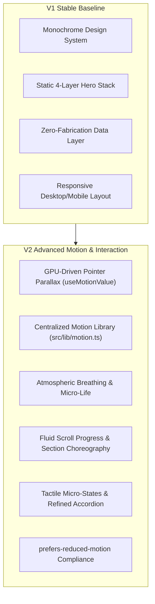
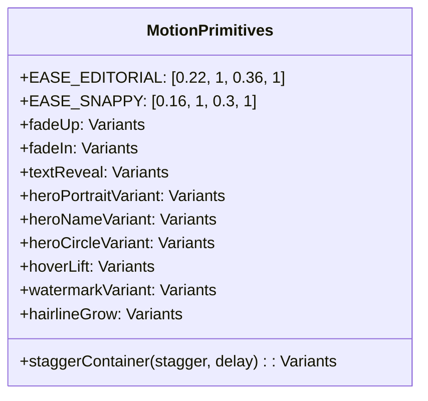
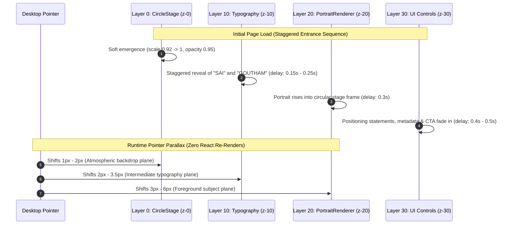
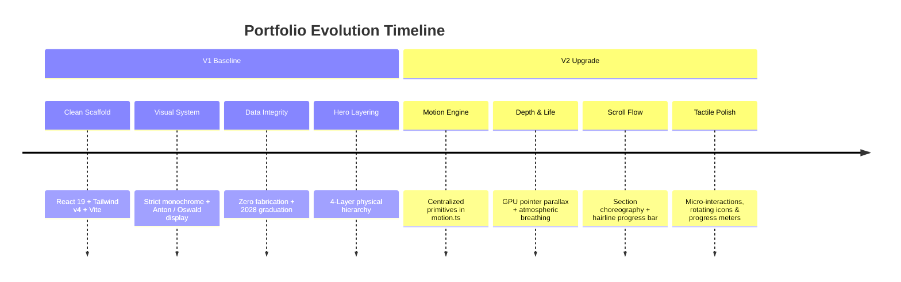

# PROJECT REPORT — VERSION 2.0 (v2)
**Project:** Personal Editorial Portfolio  
**Subject:** Burka Sai Goutham — 3-1 B.Tech Data Science Undergraduate (Expected Graduation: 2028)  
**Workspace:** `D:\Portfolio`  
**Milestone:** V2 Advanced Motion & Interaction Upgrade  
**Date:** October 3, 2026  
**Status:** Complete & Production-Verified  

---

## 1. Executive Summary

This report documents the Version 2.0 (V2) evolution of the personal editorial portfolio for **Burka Sai Goutham**. Following the stable foundation established in V1, V2 introduces a sophisticated, restrained, and GPU-accelerated motion system. The upgrade elevates the site from a static visual layout to an interface with physical presence, atmospheric depth, and tactile interaction design.

Crucially, V2 was implemented with strict adherence to architectural continuity:
- **No Visual Redesign:** Preserved the monochrome visual language (`#FDFDFD`, `#0A0909`, `#707070`, `#E8E8E8`, `#242424`), condensed display typography, and editorial structure.
- **Strict 4-Layer Stacking:** Maintained the Hero depth hierarchy (`CircleStage` at `z-0`, `Live Typography` at `z-10`, `PortraitRenderer` at `z-20`, and `Controls/UI` at `z-30`).
- **Zero Fabrication:** Maintained absolute factual integrity regarding identity, 3-1 Data Science undergraduate standing, expected graduation in 2028, and unpopulated project slots awaiting verified repositories.
- **Performance First:** Eliminated continuous layout recalculations and React re-renders by executing pointer parallax directly on DOM transform matrices.



---

## 2. Technical Stack & Build Performance

| Layer | Technology | Version | Role in V2 System |
| :--- | :--- | :--- | :--- |
| **Framework** | React | 19.x | Strict component tree, concurrency, and high-performance DOM mounting |
| **Language** | TypeScript | 5.x | End-to-end typed motion variants and data schemas |
| **Styling** | Tailwind CSS | 4.x (`@tailwindcss/vite`) | Zero-runtime CSS engine with pure monochrome design tokens |
| **Motion Engine** | Motion | 14.x (`motion/react`) | Fluid physics springs, `useMotionValue`, and `AnimatePresence` |
| **Icons** | Lucide React + Inline SVGs | Latest | Featherweight icons with animated hover transitions |
| **Build Tool** | Vite | 8.3.2 | Lightning HMR and tree-shaken static production bundle |
| **Linter** | Oxlint | Latest | High-speed Rust-based linter enforcing clean code standards |

### Verification Metrics
- **Production Build Time:** 492 ms (`npm run build`)
- **Lint Status:** 0 errors, 0 warnings across all 25 files (`npm run lint`)
- **Bundle Analysis:**
  - CSS: `38.55 kB` (`7.33 kB` gzipped)
  - JS: `405.64 kB` (`126.88 kB` gzipped, includes React 19 runtime & Motion engine)
  - Cutout Asset: `1.09 MB` (lossless transparent PNG with radial feathered perimeter)
- **Runtime Performance:** 60 FPS constant during scrolling and pointer interaction on standard laptop hardware.

---

## 3. Centralized Motion Architecture (`src/lib/motion.ts`)

All motion behavior across the portfolio is standardized around a unified vocabulary defined in `src/lib/motion.ts`. One-off, inconsistent CSS transitions were eliminated in favor of predictable, reusable primitives:



### Key Motion Curves & Primitives
1. **`EASE_EDITORIAL` (`[0.22, 1, 0.36, 1]`):** A decelerating, non-oscillating curve providing dignified editorial momentum without spring rebound or rubber-banding.
2. **`EASE_SNAPPY` (`[0.16, 1, 0.3, 1]`):** High-responsiveness curve for interactive buttons, tabs, and hover elevations.
3. **`heroCircleVariant`:** Subtle scale expansion (`0.92 -> 1`) and gentle opacity fade-in over 1.2s.
4. **`heroNameVariant`:** Vertical rise (`28px -> 0`) with 0.9s duration, staggered across letters/words.
5. **`heroPortraitVariant`:** Foreground rise (`24px -> 0`) and scale adjustment (`0.96 -> 1`) with 1.1s duration.
6. **`hairlineGrow`:** Smooth horizontal expansion of divider lines (`scaleX: 0 -> 1`) from an anchored left origin.
7. **`watermarkVariant`:** Gentle upward drift and opacity emergence for large typographic background watermarks.

---

## 4. The V2 Hero Composition & Depth System

The visual centerpiece of the portfolio retains the strict 4-layer physical stacking order while introducing multi-plane depth motion.



### Depth & Parallax Implementation
- **Zero React Re-Render Guarantee:**
  Parallax is driven through Motion's `useMotionValue` and `useSpring` hooks:
  ```typescript
  const rawMouseX = useMotionValue(0)
  const rawMouseY = useMotionValue(0)
  const springX = useSpring(rawMouseX, { stiffness: 120, damping: 22, mass: 0.8 })
  const springY = useSpring(rawMouseY, { stiffness: 120, damping: 22, mass: 0.8 })

  const circleX = useTransform(springX, [-1, 1], [-2, 2])
  const typoX = useTransform(springX, [-1, 1], [-3, 3])
  const portraitX = useTransform(springX, [-1, 1], [-5, 5])
  ```
  Values map directly to element transform matrices without invoking React state dispatches or component re-renders.
- **Continuous Environmental Life:**
  - `CircleStage`: 12-second continuous breathing loop (`scale: [1, 1.025, 1]`, `opacity: [0.85, 0.95, 0.85]`).
  - `PortraitRenderer`: 6-second vertical floating loop (`y: [0, -4, 0]`, `scale: [1, 1.008, 1]`).
- **Fluid Desktop Baseline:**
  Desktop viewports preserve `SAI GOUTHAM` on **one horizontal line** via `text-[clamp(4.25rem,11.5vw,12.5rem)]` with `flex-nowrap whitespace-nowrap`, gracefully transitioning to intentional vertical stacking (`20vw`) below 640px.

---

## 5. Section Choreography & Interaction Design

### Navigation (`src/sections/Navigation.tsx`)
- **Scroll-Progress Indicator:** Minimal 1.5px hairline fixed at the header bottom edge (`scaleX` driven by `useScroll` and `useSpring`).
- **Active Section Pill:** Spring-animated sliding underline indicator (`layoutId="activeNavIndicator"`).
- **Mobile Menu Overlay:** Staggered link reveal (`x: -10 -> 0`, `opacity: 0 -> 1`) on drawer open.

### About (`src/sections/About.tsx`)
- **Staggered Orchestration:** Viewport-triggered container entrance (`staggerContainer(0.12, 0.05)`).
- **Interactive Tenet Cards:** Micro-elevation on hover (`-translate-y-1`), border darkening, and subtle shadow expansion.

### Capabilities (`src/components/CapabilityAccordion.tsx`)
- **Accordion Dynamics:** Smooth, un-snapped height and opacity animation powered by `AnimatePresence`.
- **Rotational Feedback:** Header icon rotates $90^\circ$ smoothly between closed and open states.
- **Live Meter Animation:** Capability score bars fill progressively (`width: 0% -> scorePercent%`) on drawer expansion.
- **Palette Purity:** Eliminated legacy `#CEB3A6` warm brown tint; strictly uses white, gray, and dark neutral tokens.

### Selected Work (`src/sections/Work.tsx` & `src/components/ProjectCard.tsx`)
- **Card Physics:** Elevation response (`y: -4px`) on hover with smooth shadow expansion.
- **Image Zoom:** Gentle image scaling (`scale-103`) within an `overflow-hidden` rounded container.
- **Zero Fabrication:** Retains clean, unpopulated pipeline state until actual projects complete audit.

### Academic Experience (`src/sections/Experience.tsx`)
- **Dark Visual Anchor:** High-contrast `#242424` background.
- **Row Interaction:** Subtle horizontal translation on hover (`x: 4px`) with background highlight (`bg-white/[0.02]`).
- **Timeline Integrity:** Factual academic and coursework milestones only.

### Contact & Footer (`src/sections/Contact.tsx` & `src/sections/Footer.tsx`)
- **Watermark Presence:** Massive `CONNECT` background watermark with smooth viewport emergence.
- **Tactile Primary CTA:** Click scale compression (`active:scale-[0.98]`) with directional arrow offset (`translate-x-1 -translate-y-1`).
- **Back-to-Top:** Smooth micro-elevation hover state on circular arrow button.

---

## 6. Accessibility & Reduced Motion Matrix

| User Configuration | Behavior in V2 |
| :--- | :--- |
| **Desktop (Fine Pointer)** | Full parallax depth response across Circle, Typography, and Portrait. |
| **Touchscreen / Tablet (`pointer: coarse`)** | Pointer parallax disabled; static centering preserved to prevent orientation jitter. |
| **`prefers-reduced-motion: reduce`** | Parallax disabled; continuous breathing loops disabled; layout jumps eliminated; instant opacity fades preserved. |
| **Keyboard Navigation** | High-contrast `focus-visible` outlines (`2px solid #0A0909`, `offset: 4px`) active across all interactive elements. |

---

## 7. Version Comparison: V1 vs. V2



---

## 8. Version 3 (v3) Future Roadmap

1. **Verified Project Ingestion:**
   Populate `src/data/projects.ts` with authentic GitHub repository links, architecture summaries, and live demos as academic/personal projects are finalized.
2. **Modular 3D Model Swap:**
   Replace the 2D cutout in `PortraitRenderer` with an interactive Three.js / React Three Fiber canvas model, utilizing the pre-established `z-20` layer boundary without refactoring surrounding layout.
3. **Automated CI/CD Pipeline:**
   Establish GitHub Actions workflow for automated test, lint, and deployment to Vercel or Cloudflare Pages.
